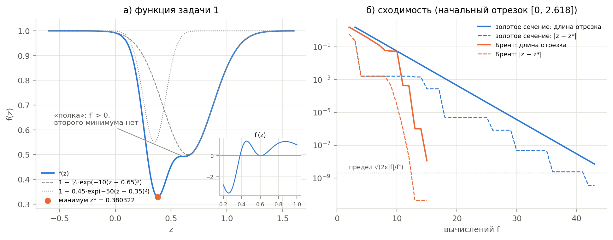
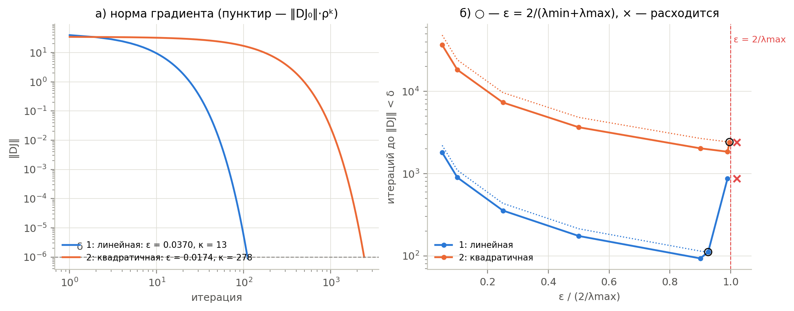
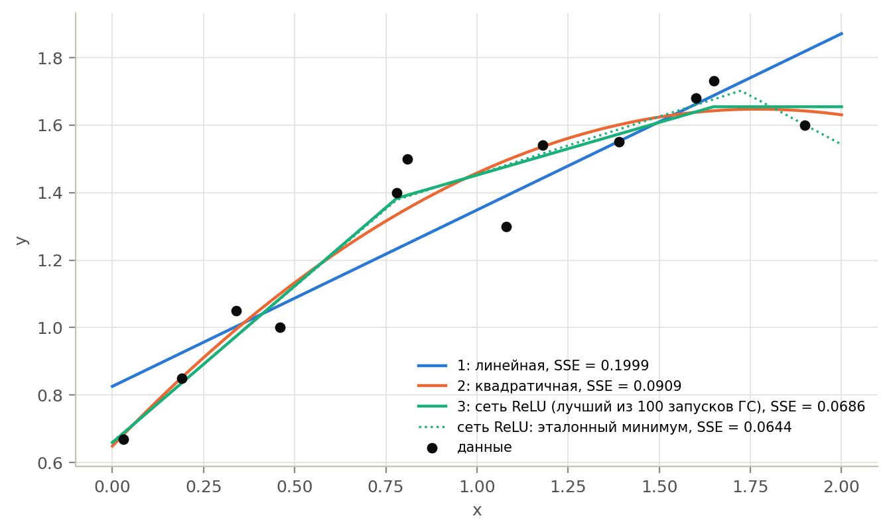
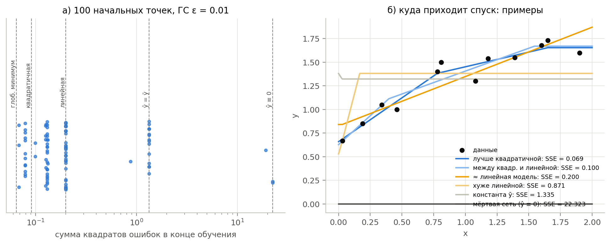
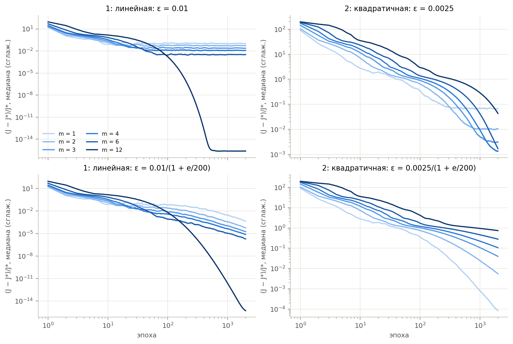
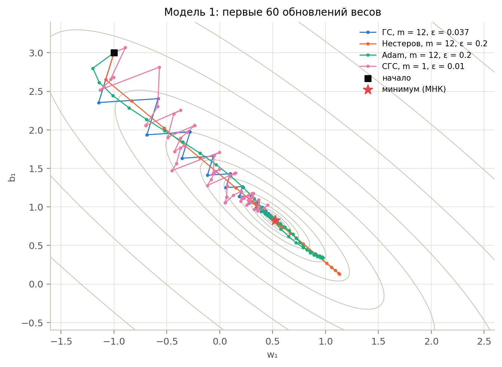
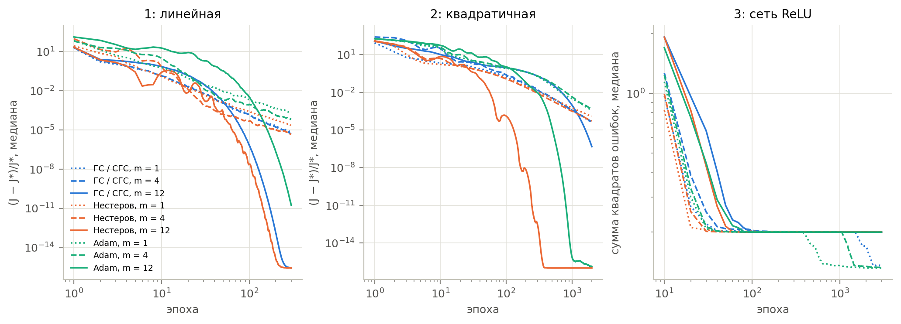
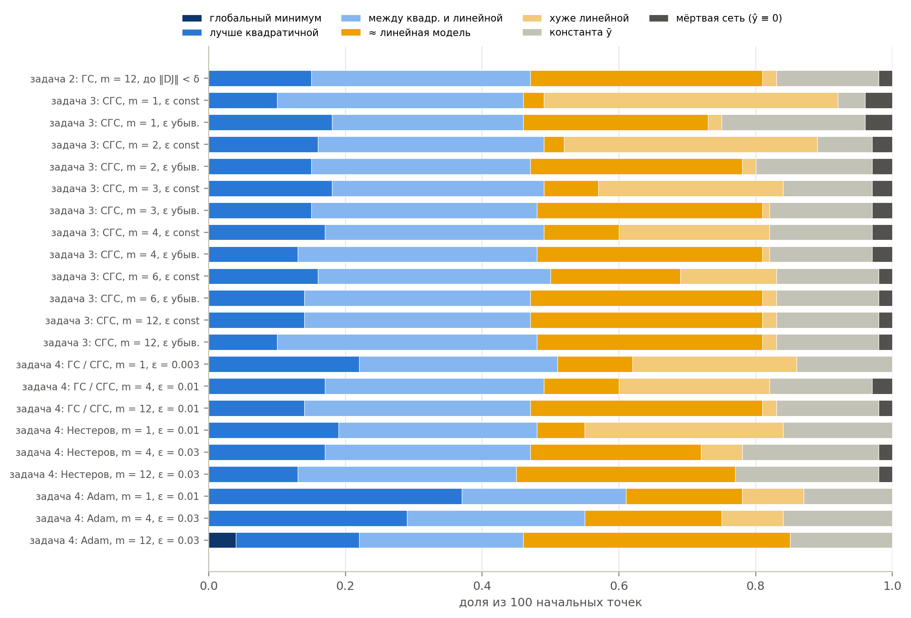
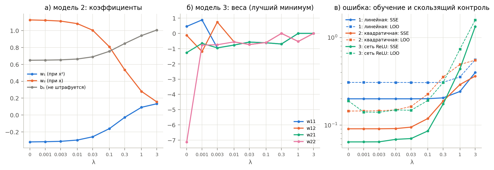
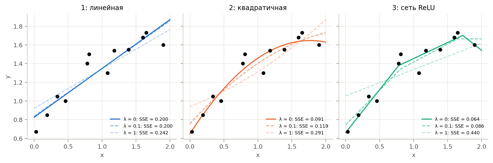

# Лабораторная работа 6. Стохастический градиентный спуск и его модификации

**Отчёт.** Решены пять задач из [lab6b.pdf](../lab6b.pdf):

1. найден минимум функции одной переменной методами золотого сечения и
   Брента [2, разд. 10.1–10.3];
2. три модели обучены классическим градиентным спуском, производные
   вычислены численно [2, разд. 5.7];
3. те же модели обучены стохастическим градиентным спуском (СГС) с
   мини-пакетами разного размера;
4. то же сделано с импульсом Нестерова и методом Adam, результаты задач
   2–4 сравнены;
5. задачи 2–4 решены с квадратичным штрафом на веса (задача 5\*).

Опора — лекция 6 [3] и книга Гудфеллоу, Бенджио, Курвилля [1]: гл. 4.3
(градиентная оптимизация, гессиан), 7.1 (штрафы на норму параметров),
8.1–8.5 (СГС, импульс, Нестеров, Adam).

Код: пакет [`sgd_lab`](src/sgd_lab) (Python, NumPy; SciPy — только для
проверки). Все числа и рисунки получены командой `python -m sgd_lab report`
(≈ 4 мин на 8 ядрах, около 15 000 запусков обучения) и воспроизводятся до
последнего знака. Полные таблицы: [results/tables.md](results/tables.md),
все числа: [results/summary.json](results/summary.json).

## Кратко о результатах

1. **Задача 1.** У функции $f(z)$ **один** минимум:
   $z^* = 0.3803215288$, $f(z^*) = 0.3286036575$. Возле $z \approx 0.6$
   только «полка»: $f'$ там падает до $0.0033$, но в ноль не обращается.
   Золотое сечение нашло минимум за 43 вычисления $f$, метод Брента — за 15.
   Ошибка обоих — $10^{-10}$–$10^{-11}$, не хуже предела
   $\sqrt{2\varepsilon_{маш}|f|/f''} \approx 2\cdot10^{-9}$, который не
   обходится уменьшением допуска.
2. **Задача 2.** Для моделей 1 и 2 градиентный спуск сходится к решению МНК
   (до $3\cdot10^{-8}$). Число итераций точно совпадает с теоретическим:
   111 и 2417. Модель 2 медленнее в 22 раза из-за плохой обусловленности:
   $\kappa = 278$ против $12.5$. Спуск устойчив только при
   $\varepsilon < 2/\lambda_{max}$. Сеть ReLU (модель 3) невыпукла: из 100
   начальных точек спуск ни разу не дошёл до глобального минимума
   (SSE = 0.0644). В 15 % случаев он нашёл модель лучше квадратичной, в 34 % —
   прямую, в 17 % — константу или «мёртвую» сеть.
3. **Задача 3.** Мини-пакеты дают больше обновлений за эпоху при той же
   цене эпохи. Поэтому в начале СГС быстрее, но он останавливается на
   «уровне шума», и этот уровень тем выше, чем меньше пакет. Скорость из
   задачи 2 для малых пакетов слишком велика: для модели 2 при $m = 1, 2$
   СГС расходится. Уменьшение скорости $\varepsilon_0/(1 + e/\tau)$ убирает
   шум и доводит СГС до $10^{-4}$–$10^{-6}$. Слишком быстрое уменьшение
   останавливает медленную модель 2. Для сети ReLU размер пакета почти не
   влияет на то, в какой минимум придёт обучение.
4. **Задача 4.** При полном пакете импульс Нестерова — лучший метод. Для
   плохо обусловленной модели 2 он доходит до $10^{-6}$ за 136 эпох, против
   1761 у спуска и 518 у Adam. С мини-пакетами все три метода упираются в
   шум, и нужно уменьшать $\varepsilon$; Adam с мини-пакетами хуже
   остальных. Для сети ReLU Adam лучше всех находит хорошие минимумы:
   37 % запусков лучше квадратичной модели против 14–22 % у остальных.
   **Итог сравнения задач 2–4:** на 12 точках полный пакет выгоднее
   мини-пакетов, а выбор метода важнее выбора размера пакета.
5. **Задача 5.** Штраф $\lambda\sum w^2$ уменьшает веса, увеличивает
   ошибку обучения и улучшает обусловленность: для модели 2 при
   $\lambda = 0.1$ $\kappa$ падает с 278 до 193, итераций спуска — с 2417
   до 1675. Все методы сходятся к одному решению — гребневой регрессии. Для
   моделей 1–2 штраф прогноз не улучшает (скользящий контроль). Для сети
   ReLU он полезен. Уже $\lambda = 0.001$ уменьшает $\sum w^2$ с 52 до 3.2
   при той же SSE: штраф выбирает из семейства эквивалентных сетей ту, где
   у каждого нейрона $|w_{\text{вх}}| = |w_{\text{вых}}|$. Ошибка скользящего
   контроля падает с 0.189 до 0.140 — уровня квадратичной модели.

---

## 0. Данные и модели

Выборка — 12 точек $(x_i, y_i)$ из задания. Функция потерь — сумма квадратов
ошибок (SSE):

```math
J(w) = \sum_{i=1}^{12} \bigl(y_i - \hat y(x_i; w)\bigr)^2 .
```

Модели: (1) $\hat y = w_1x + b_1$ — 2 параметра; (2)
$\hat y = w_1x^2 + w_2x + b_1$ — 3 параметра; (3)
$\hat y = \mathrm{ReLU}(w_{21}\mathrm{ReLU}(w_{11}x + b_{11}) + w_{22}\mathrm{ReLU}(w_{12}x + b_{12}) + b_{21})$
— 7 параметров, сеть 1–2–1. Модели 1 и 2 линейны по параметрам, их $J$ —
выпуклая квадратичная функция с точным минимумом (МНК):
$J^* = 0.19987$ и $0.09088$. Сеть 3 — кусочно-линейная функция с двумя
изломами скрытого слоя и «срезом» снизу на выходе, её $J$ невыпукла.
Эталон глобального минимума найден симплекс-методом Нелдера — Мида из
100 случайных точек: $J^* = 0.06442$ — ломаная из трёх участков.

---

## 1. Задача 1: золотое сечение и метод Брента

**Функция.** $f(z)$ — единица минус две «ямы» Гаусса: широкая глубины 0.5
у $z = 0.65$ и узкая глубины 0.45 у $z = 0.35$ (рис. 1а). Ямы перекрываются,
и широкая «съедает» второй минимум. Производная

```math
f'(z) = 10(z - 0.65)e^{-10(z-0.65)^2} + 45(z - 0.35)e^{-50(z-0.35)^2}
```

меняет знак ровно один раз (это проверяет тест). На «полке» у
$z \approx 0.606$ $f'$ падает до $0.0033$, но остаётся положительной.
Значит, минимум **единственный**, а функция унимодальна. Это условие, при
котором метод золотого сечения гарантированно сходится. Эталон
$z^* = 0.380321528824$ получен как корень $f'(z) = 0$: корень производной
находится с машинной точностью, а минимум по значениям $f$ — нет (ниже).



**Рис. 1.** а) $f(z)$, её слагаемые и производная (вставка); б) длина
отрезка неопределённости и ошибка $|z - z^*|$ в зависимости от числа
вычислений $f$.

**Алгоритмы** [2, гл. 10].

- **Начальный отрезок** (`mnbrak`, разд. 10.1). Нужна тройка
  $a < b < c$ с $f(b) < f(a), f(c)$. Из точек 0 и 1 процедура идёт под уклон,
  увеличивая шаг в $\varphi = 1.618$ раза, и за 3 вычисления находит
  $(0,\ 1,\ 2.618)$.
- **Золотое сечение** (`Golden`, разд. 10.2). Новая точка ставится на долю
  $0.382$ большего из отрезков $[a, b]$, $[b, c]$. Одна из старых точек
  остаётся внутренней, поэтому на каждый шаг нужно одно вычисление $f$, а
  отрезок сокращается ровно в $1/0.618 = \varphi$ раз (рис. 1б, прямая
  линия). Сходимость линейная: чтобы сжать отрезок 2.618 до
  $2\,\mathrm{tol}\,|z| \approx 2\cdot10^{-8}$, нужно
  $\ln(1.15\cdot10^8)/\ln\varphi \approx 39$ шагов. В опыте — 41.
- **Метод Брента** (`Brent`, разд. 10.3). Через три лучшие точки
  проводится парабола, следующей точкой берётся её вершина. Шаг
  принимается, только если вершина внутри отрезка и шаг меньше половины
  позапрошлого. Иначе делается шаг золотого сечения. Вблизи гладкого
  минимума функция почти квадратична, и параболические шаги сходятся
  сверхлинейно. Из 14 итераций 9 были параболическими, 5 — золотыми.

**Таблица 1.** Минимум $f(z)$: свои реализации и `scipy.optimize.minimize_scalar` с тем же начальным отрезком.

<!-- table:1 -->
| метод | z* | f(z*) | \|z − z*\| | итераций | вычислений f |
|---|---:|---:|---:|---:|---:|
| золотое сечение (своё) | 0.3803215292 | 0.3286036575 | 3.4e-10 | 41 | 43 |
| Брент (своё) | 0.3803215288 | 0.3286036575 | 4.3e-11 | 14 | 15 |
| золотое сечение (SciPy) | 0.3803215280 | 0.3286036575 | 8.1e-10 | 41 | 46 |
| Брент (SciPy) | 0.3803215288 | 0.3286036575 | 3.9e-11 | 14 | 17 |
<!-- /table -->

Свои реализации совпадают с SciPy по числу итераций: 41 и 14 (это проверяет
тест). Брент тратит в 3 раза меньше вычислений $f$.

**Предел точности.** Вблизи минимума
$f(z) \approx f(z^*) + \tfrac12 f''(z^*)(z - z^*)^2$. Значения
$f$ в точках, отстоящих от $z^*$ меньше чем на

```math
\delta z \approx \sqrt{2\varepsilon_{маш}|f(z^*)|/f''(z^*)} = \sqrt{2\cdot2.2\cdot10^{-16}\cdot0.329/36.8} \approx 2\cdot10^{-9},
```

в арифметике двойной точности неразличимы ((10.1.2) в [2]). Поэтому допуск
по умолчанию $\mathrm{tol} = 3\cdot10^{-8} \approx \sqrt{\varepsilon_{маш}}$.
Табл. 2 это подтверждает: при уменьшении $\mathrm{tol}$ ниже $10^{-8}$ число
вычислений растёт, а ошибка остаётся на уровне $10^{-10}$–$10^{-9}$. Если она
падает ниже $\delta z$, это случайность, а не гарантия.

**Таблица 2.** Допуск, ошибка и число вычислений $f$.

<!-- table:2 -->
| tol | золотое сечение: \|z − z*\| | вычислений f | Брент: \|z − z*\| | вычислений f |
|---|---:|---:|---:|---:|
| 1e-2 | 2.7e-4 | 15 | 1.6e-3 | 9 |
| 1e-3 | 5.1e-6 | 19 | 2.8e-5 | 11 |
| 1e-4 | 5.1e-6 | 24 | 9.9e-6 | 12 |
| 1e-5 | 8.2e-7 | 29 | 1.0e-6 | 13 |
| 1e-6 | 4.6e-8 | 34 | 1.9e-8 | 14 |
| 1e-7 | 2.4e-9 | 39 | 1.9e-8 | 14 |
| 3e-8 | 2.4e-9 | 41 | 4.3e-11 | 14 |
| 1e-9 | 5.9e-11 | 48 | 4.3e-11 | 18 |
| 1e-10 | 5.9e-11 | 53 | 7.6e-10 | 24 |
| 1e-12 | 5.9e-11 | 62 | 7.9e-10 | 34 |
<!-- /table -->

**Начальные точки** (табл. 3). Из любых точек, где $f$ заметно меняется,
`mnbrak` находит отрезок с минимумом, и оба метода приходят в $z^*$. Даже
старт $(2, 3)$ работает: там $f$ отличается от 1 на $10^{-9}$. Старт
$(5, 6)$ — пример отказа. Там $e^{-10(z-0.65)^2} < 10^{-80}$, и в
машинной арифметике $f(5) = f(6) = f(7.6) = 1$ ровно. Направления спуска
нет, «отрезок» $(5, 6, 7.6)$ минимума не содержит, и методы возвращают
произвольную точку. Методы одномерного поиска не отличают плато от минимума.
Начальный отрезок нужно выбирать там, где функция меняется. То же верно для
градиентных методов на плато (раздел 2.3).

**Таблица 3.** Поиск отрезка из разных начальных точек.

<!-- table:3 -->
| начальные точки | отрезок (a, b, c) | вычислений f (mnbrak) | Брент: z | золотое сечение: z |
|---|---:|---:|---:|---:|
| 0, 1 | 0, 1, 2.618 | 3 | 0.38032153 | 0.38032153 |
| 0.6, 0.7 | 0.1764, 0.4382, 0.6 | 4 | 0.38032153 | 0.38032153 |
| -3, -2 | -2, -0.382, 2.236 | 4 | 0.38032153 | 0.38032153 |
| 2, 3 | -2.236, 0.382, 2 | 4 | 0.38032153 | 0.38032153 |
| 5, 6 | 5, 6, 7.618 | 3 | 7.61803378 | 5.00000008 |
<!-- /table -->

---

## 2. Задача 2: классический градиентный спуск

Алгоритм — лекция 6, [1, разд. 4.3]: $w_{j+1} = w_j - \varepsilon\,D_wJ(w_j)$,
градиент по всей выборке, остановка при
$\lVert D_wJ\rVert < \delta = 10^{-6}$ (не позже $10^5$ итераций).

**Численный градиент** [2, разд. 5.7]. Производные вычисляются центральной
разностью

```math
\frac{\partial J}{\partial w_k} \approx \frac{J(w + h_k e_k) - J(w - h_k e_k)}{2h_k},
\qquad h_k = \varepsilon_{маш}^{1/3}\max(|w_k|, 1) \approx 6\cdot10^{-6}\max(|w_k|, 1).
```

Такой шаг уравновешивает погрешность усечения $\sim h^2 J'''$ и округления
$\sim\varepsilon_{маш}J/h$ (формула (5.7.8) [2]). Шаг делается точно
представимым: `h = (w + h) - w` (5.7.4). Все $2p$ значений $J$ вычисляются
одним векторизованным вызовом. Сверка с аналитическим градиентом (табл. 4):
относительная ошибка не больше $2\cdot10^{-10}$. Для обучения это то же
самое, что точный градиент. Метод Риддерса (`dfridr`, там же) даёт
$10^{-14}$–$10^{-15}$, но требует до 10 пар вычислений $J$ вместо одной, и при обучении не нужен.

**Таблица 4.** Ошибка численного градиента в 20 случайных точках каждой модели.

<!-- table:4 -->
| модель | max \|ошибка\| | max отн. ошибка | метод Риддерса: \|ошибка\| ∂J/∂w₁ |
|---|---:|---:|---:|
| 1 (линейная) | 3.1e-9 | 2.6e-11 | 2.1e-14 |
| 2 (квадратичная) | 6.7e-9 | 3.4e-11 | 1.4e-14 |
| 3 (сеть ReLU) | 1.6e-9 | 1.7e-10 | 1.6e-15 |
<!-- /table -->

### 2.1. Модели 1 и 2: выбор скорости обучения

Для квадратичной $J$ с гессианом $H = 2A^TA$ (строки $A$ — $(x_i, 1)$ или
$(x_i^2, x_i, 1)$) градиент $g_j = H(w_j - w^*)$, и шаг спуска даёт

```math
g_{j+1} = (I - \varepsilon H)\, g_j \quad\Rightarrow\quad
\lVert g_j\rVert \le \rho^j \lVert g_0\rVert,\qquad \rho = \max_i |1 - \varepsilon\lambda_i| .
```

Отсюда три вывода [1, разд. 4.3.1, 8.2.1]:

- спуск устойчив, только если $\varepsilon < 2/\lambda_{max}$;
- лучшая гарантия — при $\varepsilon = 2/(\lambda_{min} + \lambda_{max})$,
  тогда $\rho = (\kappa - 1)/(\kappa + 1)$, где
  $\kappa = \lambda_{max}/\lambda_{min}$ — число обусловленности;
- число итераций $\approx \ln(\lVert g_0\rVert/\delta)/\ln(1/\rho) \approx \tfrac{\kappa}{2}\ln(\lVert g_0\rVert/\delta)$
  растёт пропорционально $\kappa$.

**Таблица 5.** Градиентный спуск при $\varepsilon = 2/(\lambda_{min} + \lambda_{max})$ из начальной точки $w_0 \sim \mathcal N(0, 1)$ (зерно 0).

<!-- table:5 -->
| модель | λmin(H) | λmax(H) | κ | 2/λmax | ε = 2/(λmin+λmax) | итераций | оценка ⌈ln(δ/‖DJ₀‖)/ln ρ⌉ | max \|w − w_МНК\| | SSE |
|---|---:|---:|---:|---:|---:|---:|---:|---:|---:|
| 1 (линейная) | 3.994 | 50.03 | 12.5 | 0.03998 | 0.03702 | 111 | 111 | 1.9e-8 | 0.19987 |
| 2 (квадратичная) | 0.410 | 114.21 | 278.4 | 0.01751 | 0.01745 | 2 417 | 2 417 | 2.7e-8 | 0.09088 |
<!-- /table -->

Оба спуска сошлись к решению МНК. Число итераций **в точности** совпало с
оценкой: 111 и 2417. При оптимальной $\varepsilon$ обе крайние компоненты
градиента убывают с одним множителем $\rho$, и оценка становится точной.

Модель 2 медленнее в 22 раза, потому что у неё $\kappa = 278$. Столбцы
$x^2$, $x$, $1$ на отрезке $[0, 2]$ почти линейно зависимы, и гессиан плохо
обусловлен [1, разд. 4.2, 8.2.1]. Вдоль направления с малым
$\lambda_{min} = 0.41$ спуск ползёт (рис. 2а, длинный пологий участок).
Каждый шаг уменьшает градиент лишь в $1/0.9928$ раза.

**Таблица 6.** Скорость обучения и число итераций; в скобках — оценка $\lceil\ln(\delta/\lVert g_0\rVert)/\ln\rho\rceil$.

<!-- table:6 -->
| ε / (2/λmax) | модель 1: ε | ρ | итераций | модель 2: ε | ρ | итераций |
|---|---:|---:|---:|---:|---:|---:|
| 0.05 | 0.00200 | 0.9920 | 1 800 (2 203) | 0.00088 | 0.9996 | 36 627 (48 332) |
| 0.1 | 0.00400 | 0.9840 | 896 (1 097) | 0.00175 | 0.9993 | 18 310 (24 162) |
| 0.25 | 0.00999 | 0.9601 | 355 (434) | 0.00438 | 0.9982 | 7 321 (9 660) |
| 0.5 | 0.01999 | 0.9202 | 174 (213) | 0.00876 | 0.9964 | 3 657 (4 826) |
| 0.9 | 0.03598 | 0.8563 | 93 (114) | 0.01576 | 0.9935 | 2 029 (2 677) |
| 0.99 | 0.03958 | 0.9800 | 874 (874) | 0.01734 | 0.9929 | 1 844 (2 433) |
| 1.02 | 0.04078 | 1.0400 | расходится | 0.01786 | 1.0400 | расходится |
| 2/(λmin+λmax): 0.926 и 0.9964 | 0.03702 | 0.8521 | 111 (111) | 0.01745 | 0.9928 | 2 417 (2 417) |
<!-- /table -->



**Рис. 2.** а) Норма градиента по итерациям при оптимальной $\varepsilon$
(пунктир — оценка $\lVert g_0\rVert\rho^k$); б) число итераций в
зависимости от $\varepsilon$.

Табл. 6 и рис. 2б показывают три режима:

- **Малые $\varepsilon$.** Итераций $\propto 1/\varepsilon$: 1800 при
  $0.05\cdot2/\lambda_{max}$ против 174 при $0.5\cdot2/\lambda_{max}$.
- **Предел $\varepsilon \to 2/\lambda_{max}$.** Компонента вдоль
  $\lambda_{max}$ начинает колебаться с множителем $1 - \varepsilon\lambda_{max} \to -1$,
  и для модели 1 число итераций снова растёт до 874.
- **$\varepsilon > 2/\lambda_{max}$.** Спуск расходится, уже при превышении
  на 2 %.

Оценка по $\rho$ — верхняя. При $0.9\cdot2/\lambda_{max}$ итераций даже
меньше, чем при «оптимальной» $\varepsilon$: 93 против 111 и 2029 против
2417. Компонента градиента вдоль $\lambda_{min}$ с самого начала мала
($g = H(w - w^*)$ умножает её на $\lambda_{min}$), поэтому важнее быстро
погасить компоненту вдоль $\lambda_{max}$.

### 2.2. Найденные зависимости



**Рис. 3.** Данные и модели, обученные градиентным спуском. Для сети ReLU
показан лучший из 100 запусков спуска и эталонный глобальный минимум.

Прямая (SSE = 0.200) не описывает насыщения $y$ при больших $x$.
Квадратичная модель (0.091) описывает выпуклую вверх форму. Сеть ReLU
строит ломаную: рост, затем меньший рост, затем полка (0.064–0.069). Это
лучшее описание обучающей выборки, но ценой 7 параметров на 12 точек
(о прогнозе — раздел 5).

### 2.3. Модель 3: невыпуклая функция потерь

**Инициализация.** Применена инициализация Хе [1, разд. 8.4]:
$w \sim \mathcal N(0, 2/n_{\text{вх}})$, смещения скрытых нейронов 0.1,
смещение выхода $\bar y = 1.32$ («по маргинальной статистике выхода», там
же). Если смещение выхода тоже взять 0.1, в **23 %** начальных точек
выходной ReLU «мёртв» на всей выборке. Тогда $D_wJ = 0$ точно, спуск
останавливается на нулевой итерации по критерию $\lVert DJ\rVert < \delta$,
и $\hat y \equiv 0$. Это плато, а не минимум [1, разд. 6.3.1, 8.2.3], как
плато $f \equiv 1$ в задаче 1. При смещении $\bar y$ мёртвых начальных
точек нет.

**Таблица 7.** Куда приходит градиентный спуск ($\varepsilon = 0.01$, $\delta = 10^{-6}$, не больше $5\cdot10^4$ итераций) из 100 начальных точек.

<!-- table:7 -->
| куда пришёл спуск | SSE | запусков | доля |
|---|---:|---:|---:|
| глобальный минимум | ≤ 0.0651 | 0 | 0 % |
| лучше квадратичной | 0.0651–0.0909 | 15 | 15 % |
| между квадр. и линейной | 0.0909–0.1979 | 32 | 32 % |
| ≈ линейная модель | ≈ 0.1999 | 34 | 34 % |
| хуже линейной | прочие | 2 | 2 % |
| константа ȳ | ≈ 1.3352 | 15 | 15 % |
| мёртвая сеть (ŷ ≡ 0) | ≈ 22.32 | 2 | 2 % |
<!-- /table -->



**Рис. 4.** а) Сумма квадратов ошибок в конце обучения для 100 начальных
точек; б) примеры найденных зависимостей разного типа.

84 запуска остановились по критерию $\lVert DJ\rVert < \delta$ (медиана —
316 итераций), 16 не успели за $5\cdot10^4$. Остановка по малому
градиенту **не означает** глобального минимума. Лекция 6 предупреждает:
«мы можем найти только некий локальный минимум». Типы конечных точек:

- **Ломаная из трёх участков** (15 %, лучшая — SSE = 0.0686, эталон —
  0.0644). Минимумов такого типа много: излом может оказаться между
  разными соседними точками выборки. Эталонный поиск нашёл значения 0.0644,
  0.0686, 0.0778, 0.0788, 0.0995, …
- **Ломаная из двух участков** (SSE от 0.091 до 0.198, 32 %). Один нейрон работает
  линейно на всей выборке.
- **Прямая** (34 %). Оба нейрона активны везде или один выключен. Сеть
  вырождается в модель 1, SSE = 0.1999.
- **Константа $\bar y$** (15 %). Оба скрытых нейрона погасли на всей
  выборке, градиент по их весам равен нулю.
- **Мёртвая сеть** (2 %). Выходной ReLU погас уже *в ходе* обучения.

Ни один из 100 запусков не дошёл до глобального минимума. В эталонном
минимуме $w_{22} = -7.1$ и $\sum w^2 = 52$: веса «недопустимо большие»
(лекция 6), к этому вернёмся в задаче 5.

---

## 3. Задача 3: СГС с мини-пакетами

**Алгоритм** (лекция 6, «Минипакеты»; [1, разд. 8.1.3, 8.3.1]). На каждом
шаге градиент считается по случайному мини-пакету $B$ из $m$ наблюдений.
Пакеты выбираются без повторений, пока не будет обойдена вся выборка
(эпоха), затем выборка перемешивается заново (это проверяет тест). Чтобы
скорость $\varepsilon$ имела один смысл при любом $m$, по пакету
вычисляется *несмещённая* оценка той же функции потерь:

```math
J_B(w) = \frac{n}{m}\sum_{i\in B}(y_i - \hat y_i)^2,\qquad \mathbb E\, D_wJ_B = D_wJ .
```

Размеры пакета — делители 12: $m = 1, 2, 3, 4, 6, 12$ (при $m = 12$ это
задача 2). **Цена эпохи одинакова при любом $m$:** численный градиент по
пакету стоит $2p\cdot m$ вычислений невязки, за эпоху — $2p\cdot n$.
Поэтому сравнение по эпохам — это сравнение при равных вычислениях.
Меньший пакет даёт за ту же цену больше обновлений ($12/m$), но каждое —
по шумной оценке градиента.

**Таблица 8.** Модель 1: СГС с мини-пакетами (20 запусков, 2000 эпох). Уровень шума — среднее $(J - J^*)/J^*$ за последние 10 % эпох; «начиная с эпохи» — эпоха, после которой $(J - J^*)/J^*$ остаётся ниже $10^{-3}$ до конца.

<!-- table:8 -->
| m | обновлений за эпоху | граница ε (худший пакет) | ε = 0.0370 (из задачи 2): (J−J*)/J* | ε = 0.01: уровень шума (J−J*)/J* | ≤ 10⁻³ начиная с эпохи | ε = 0.01/(1 + e/200): (J−J*)/J* | ≤ 10⁻³ начиная с эпохи |
|---|---:|---:|---:|---:|---:|---:|---:|
| 1 | 12 | 0.0181 | 1.0e2 | 3.7e-1 | не дост. | 4.8e-4 | 2 000 |
| 2 | 6 | 0.0200 | 1.3e0 | 1.2e-1 | не дост. | 1.0e-4 | 1 676 |
| 3 | 4 | 0.0210 | 4.8e-1 | 4.8e-2 | не дост. | 2.4e-5 | 979 |
| 4 | 3 | 0.0225 | 5.1e-1 | 2.2e-2 | не дост. | 8.6e-6 | 678 |
| 6 | 2 | 0.0260 | 8.3e-1 | 6.4e-3 | не дост. | 1.8e-6 | 343 |
| 12 | 1 | 0.0400 | 2.1e-16 | 2.8e-16 | 99 | 2.8e-16 | 128 |
<!-- /table -->

**Таблица 9.** Модель 2: то же.

<!-- table:9 -->
| m | обновлений за эпоху | граница ε (худший пакет) | ε = 0.0174 (из задачи 2): (J−J*)/J* | ε = 0.0025: уровень шума (J−J*)/J* | ≤ 10⁻³ начиная с эпохи | ε = 0.0025/(1 + e/200): (J−J*)/J* | ≤ 10⁻³ начиная с эпохи |
|---|---:|---:|---:|---:|---:|---:|---:|
| 1 | 12 | 0.0047 | ∞, разошлись 20 | 1.1e-1 | не дост. | 7.3e-5 | 1 674 |
| 2 | 6 | 0.0058 | ∞, разошлись 15 | 2.2e-2 | не дост. | 4.7e-3 | не дост. |
| 3 | 4 | 0.0064 | 3.9e0 | 6.7e-3 | не дост. | 3.6e-2 | не дост. |
| 4 | 3 | 0.0074 | 4.5e0 | 2.7e-3 | 2 000 | 9.8e-2 | не дост. |
| 6 | 2 | 0.0095 | 1.4e0 | 1.4e-3 | не дост. | 2.7e-1 | не дост. |
| 12 | 1 | 0.0175 | 5.9e-11 | 3.9e-2 | не дост. | 7.2e-1 | не дост. |
<!-- /table -->



**Рис. 5.** Медиана $(J - J^*)/J^*$ по 20 запускам (сглажена в
логарифмическом масштабе); сверху — постоянная скорость, снизу —
убывающая.

Выводы:

1. **Скорость из задачи 2 для мини-пакетов слишком велика.** Гессиан оценки
   по пакету $\tfrac{2n}{m}A_B^TA_B$ имеет большее $\lambda_{max}$, чем
   полный. Граница устойчивости для худшего пакета (3-й столбец) при
   $m = 1$ вдвое ниже для модели 1 и вчетверо — для модели 2. С
   $\varepsilon = 0.0174$ из задачи 2 СГС для модели 2 расходится при
   $m = 1$ (20 из 20) и $m = 2$ (15 из 20). Для модели 1 при $m = 1$ ошибка
   в 100 раз больше минимума. Поэтому ниже взята общая скорость,
   устойчивая для всех $m$: половина границы при $m = 1$, то есть 0.01 и
   0.0025.
2. **В начале меньший пакет быстрее, но останавливается на шуме.** Рис. 5
   сверху: за первые 100 эпох кривые с $m = 1$ ниже всех, потому что
   обновлений в 12 раз больше. Затем каждая выходит на свой уровень шума,
   тем выше, чем меньше $m$: для модели 1 от 0.37 при $m = 1$ до $6\cdot10^{-3}$
   при $m = 6$. Только полный пакет сходится до $10^{-16}$. В окрестности
   минимума средний градиент мал, а разброс градиентов по пакетам — нет. СГС
   «не сходится в классическом смысле» (лекция 6). Разброс оценки при выборе
   без повторений $\propto (n - m)/(m(n - 1))$, при $m = n$ он ноль. Для
   модели 2 при $\varepsilon = 0.0025$ полный спуск за 2000 эпох доходит лишь
   до $4\cdot10^{-2}$: у этой модели $\kappa = 278$, и малая скорость
   тормозит. Здесь меньшие пакеты выигрывают, при $m = 4$–$6$ —
   $(1.4\text{–}2.7)\cdot10^{-3}$.
3. **Уменьшение скорости убирает шум** (рис. 5 снизу). При
   $\varepsilon_e = \varepsilon_0/(1 + e/\tau)$ выполнены условия
   $\sum\varepsilon = \infty$, $\sum\varepsilon^2 < \infty$
   [1, (8.12)–(8.13)]. Для модели 1 ошибка в конце упала с уровня шума до
   $4.8\cdot10^{-4}$ ($m = 1$) и $1.8\cdot10^{-6}$ ($m = 6$) и продолжает
   падать. Но уменьшение — не бесплатное: $\sum_e\varepsilon_e$ за 2000
   эпох вчетверо меньше, чем при постоянной скорости. Для медленной модели 2
   это критично: при $m \ge 2$ ошибка с уменьшением **хуже**, чем без него.
   Выиграл только $m = 1$, у него больше всего обновлений: $7.3\cdot10^{-5}$.
   Закон уменьшения нужно согласовывать с обусловленностью задачи.
4. **Модель 3** (табл. 10). Доля запусков лучше квадратичной модели —
   10–18 % при любом $m$ и любом законе скорости. Глобального минимума не
   нашёл ни один запуск. Разница между строками — в пределах статистической
   погрешности: при 100 запусках и доле около 15 % стандартная ошибка
   ±3.6 п. п. Лекция 6 говорит, что СГС «в целом позволяет избегать
   локальных минимумов». Здесь это не проявилось. Минимумы сети разделены
   переключением нейронов (включён/выключен на части выборки), и шума
   мини-пакетов на 12 точках не хватает, чтобы перевести нейрон через такой
   барьер.

**Таблица 10.** Модель 3: исходы СГС для разных размеров пакета.

<!-- table:10 -->
| m | ε | глобальный минимум | лучше квадратичной модели | медиана SSE | ŷ = const |
|---|---:|---:|---:|---:|---:|
| 1 | постоянная | 0 % | 10 % | 0.2026 | 8 % |
| 1 | /(1 + e/300) | 0 % | 18 % | 0.1999 | 25 % |
| 2 | постоянная | 0 % | 16 % | 0.2008 | 11 % |
| 2 | /(1 + e/300) | 0 % | 15 % | 0.1999 | 20 % |
| 3 | постоянная | 0 % | 18 % | 0.1995 | 16 % |
| 3 | /(1 + e/300) | 0 % | 15 % | 0.1999 | 18 % |
| 4 | постоянная | 0 % | 17 % | 0.2000 | 18 % |
| 4 | /(1 + e/300) | 0 % | 13 % | 0.1999 | 18 % |
| 6 | постоянная | 0 % | 16 % | 0.1664 | 17 % |
| 6 | /(1 + e/300) | 0 % | 14 % | 0.1999 | 17 % |
| 12 | постоянная | 0 % | 14 % | 0.1999 | 17 % |
| 12 | /(1 + e/300) | 0 % | 10 % | 0.1999 | 17 % |
<!-- /table -->

---

## 4. Задача 4: импульс Нестерова и Adam

**Формулы лекции 6** ($g = D_wJ_B$):

```math
\text{Нестеров:}\quad m_{j+1} = \beta m_j + (1-\beta)\,g(w_j - \varepsilon\beta m_j),\qquad w_{j+1} = w_j - \varepsilon m_{j+1};
```

```math
\text{Adam:}\quad m_{j+1} = \beta m_j + (1-\beta)g,\quad v_{j+1} = \gamma v_j + (1-\gamma)g^2,\quad
w_{j+1} = w_j - \varepsilon\,\frac{m_{j+1}/(1-\beta^{j+1})}{\sqrt{v_{j+1}/(1-\gamma^{j+1})} + \epsilon},
```

$\beta = 0.9$, $\gamma = 0.999$, $\epsilon = 10^{-8}$. Оба метода
реализованы по формулам; тест сверяет два шага с ручным вычислением.

Замечание о записи импульса. В лекции у градиента стоит множитель
$(1-\beta)$, у Гудфеллоу [1, алгоритм 8.3] его нет:
$v \leftarrow \alpha v - \varepsilon' g(\theta + \alpha v)$. Записи
эквивалентны при $v = -\varepsilon m$ и $\varepsilon' = (1-\beta)\varepsilon$.
Поэтому «лекционная» $\varepsilon$ для Нестерова в $1/(1-\beta) = 10$ раз
больше той же по смыслу величины у Гудфеллоу. Это объясняет, почему
наилучшие $\varepsilon$ для Нестерова (0.1–0.2) больше границы $2/\lambda_{max}$
для простого спуска. Первый шаг Adam после коррекции смещения — ровно
$\varepsilon\cdot\mathrm{sign}(g)$ по каждой координате (это проверяет тест).

**Постановка сравнения.** Для каждой модели, метода и размера пакета
$m \in \{1, 4, 12\}$ скорость $\varepsilon$ выбиралась по сетке
$0.0005, 0.001, 0.002, 0.005, \dots, 0.5$. Для $m < 12$ дополнительно
пробовался закон $\varepsilon_0/(1 + e/\tau)$. Критерий для моделей 1–2 —
медиана ошибки в конце (10 зёрен), при равенстве — скорость достижения
$10^{-6}$. Для сети — доля запусков лучше квадратичной модели (100 начальных
точек). Затем выбранные настройки прогнаны на 20 новых зёрнах (табл. 11, 12).
Без подбора скорости сравнение методов бессмысленно: у каждого своя
«естественная» шкала $\varepsilon$ [1, разд. 8.5.4, 11.4.1].

**Таблица 11.** Модели 1 и 2: лучшие настройки методов. «Начиная с эпохи» — эпоха, после которой $(J - J^*)/J^*$ остаётся ниже порога до конца; «не дост.» — у большинства запусков не достигнуто.

<!-- table:11 -->
| модель | метод | m | ε | (J−J*)/J* в конце | ≤ 10⁻³ начиная с эпохи | ≤ 10⁻⁶ начиная с эпохи | дошли до 10⁻⁶ |
|---|---|---|---:|---:|---:|---:|---:|
| 1 (линейная) | ГС / СГС | 1 | 0.005/(1 + e/10) | 4.8e-6 | 70 | не дост. | 1 из 20 |
| 1 (линейная) | ГС / СГС | 4 | 0.02/(1 + e/10) | 3.6e-6 | 70 | не дост. | 2 из 20 |
| 1 (линейная) | ГС / СГС | 12 | 0.02 | 4.9e-16 | 48 | 90 | 20 из 20 |
| 1 (линейная) | Нестеров | 1 | 0.005/(1 + e/10) | 1.7e-5 | 104 | не дост. | 2 из 20 |
| 1 (линейная) | Нестеров | 4 | 0.02/(1 + e/10) | 6.9e-6 | 43 | не дост. | 4 из 20 |
| 1 (линейная) | Нестеров | 12 | 0.2 | 2.8e-16 | 38 | 80 | 20 из 20 |
| 1 (линейная) | Adam | 1 | 0.05/(1 + e/10) | 1.2e-4 | 290 | не дост. | 0 из 20 |
| 1 (линейная) | Adam | 4 | 0.2/(1 + e/10) | 4.7e-5 | 228 | не дост. | 0 из 20 |
| 1 (линейная) | Adam | 12 | 0.2 | 1.5e-12 | 110 | 178 | 19 из 20 |
| 2 (квадратичная) | ГС / СГС | 1 | 0.005/(1 + e/70) | 4.6e-5 | 1 300 | не дост. | 1 из 20 |
| 2 (квадратичная) | ГС / СГС | 4 | 0.02/(1 + e/70) | 3.5e-5 | 1 316 | не дост. | 0 из 20 |
| 2 (квадратичная) | ГС / СГС | 12 | 0.01 | 1.4e-7 | 921 | 1 761 | 18 из 20 |
| 2 (квадратичная) | Нестеров | 1 | 0.005/(1 + e/70) | 8.6e-5 | 1 880 | не дост. | 0 из 20 |
| 2 (квадратичная) | Нестеров | 4 | 0.02/(1 + e/70) | 3.2e-5 | 1 012 | не дост. | 0 из 20 |
| 2 (квадратичная) | Нестеров | 12 | 0.1 | -5.3e-16 | 62 | 136 | 20 из 20 |
| 2 (квадратичная) | Adam | 1 | 0.02/(1 + e/70) | 2.4e-4 | 1 994 | не дост. | 0 из 20 |
| 2 (квадратичная) | Adam | 4 | 0.05/(1 + e/70) | 3.3e-4 | 1 990 | не дост. | 0 из 20 |
| 2 (квадратичная) | Adam | 12 | 0.1 | 3.1e-16 | 358 | 518 | 19 из 20 |
<!-- /table -->



**Рис. 6.** Первые 60 обновлений весов модели 1 на линиях уровня $J(w_1, b_1)$.



**Рис. 7.** Медианные кривые обучения выбранных настроек: сплошные —
$m = 12$, штриховые — $m = 4$, пунктир — $m = 1$.

**Полный пакет** ($m = 12$):

- **Нестеров — лучший.** Для модели 2 ошибка $\le 10^{-6}$ держится с эпохи
  136, у спуска — с 1761 (13× медленнее), у Adam — с 518. Импульс
  накапливает шаги вдоль пологого направления (малое $\lambda_{min}$) и
  гасит колебания вдоль крутого. Для квадратичной функции это заменяет
  зависимость числа итераций от $\kappa$ на $\sqrt\kappa$
  [1, разд. 8.3.2–8.3.3; 4]. На рис. 6 спуск идёт зигзагом поперёк узкой
  долины, а Нестеров — почти по её дну.
- **Adam** частично компенсирует плохую обусловленность: делит шаг каждой
  координаты на $\sqrt{v}$. Но шаг Adam при постоянной $\varepsilon$ имеет
  порядок $\varepsilon$ вблизи минимума, и метод колеблется вокруг него
  (лекция 6, «алгоритм нормировки … колеблется»). Убывающий вес импульса
  это гасит, но медленно: модель 1 — 178 эпох до $10^{-6}$ против 80 у
  Нестерова.

**Мини-пакеты** ($m = 1, 4$). Все три метода упираются в шум, и лучшие
настройки в сетке — с убывающей скоростью. За отведённые эпохи медианная
ошибка $10^{-6}$–$10^{-4}$, порог $10^{-6}$ держат лишь единицы из 20
запусков. Импульс шума не убирает: он усредняет градиенты, но за
$\sim 1/(1-\beta) = 10$ шагов, а это меньше одной эпохи при $m = 1$. Adam с
мини-пакетами хуже остальных: $5\cdot10^{-5}$–$3\cdot10^{-4}$ против
$4\cdot10^{-6}$–$9\cdot10^{-5}$ у спуска и Нестерова.
Нормировка $m/\sqrt v$ делает шаг порядка $\varepsilon$ *независимо* от
величины градиента, и у минимума, где средний градиент мал, а шум — нет,
Adam шагает в основном по шуму.

**Таблица 12.** Модель 3: исходы при лучших настройках методов (100 начальных точек).

<!-- table:12 -->
| метод | m | ε | глобальный минимум | лучше квадратичной модели | медиана SSE | ŷ = const |
|---|---|---:|---:|---:|---:|---:|
| ГС / СГС | 1 | 0.003 | 0 % | 22 % | 0.1331 | 14 % |
| ГС / СГС | 4 | 0.01 | 0 % | 17 % | 0.2000 | 18 % |
| ГС / СГС | 12 | 0.01 | 0 % | 14 % | 0.1999 | 17 % |
| Нестеров | 1 | 0.01 | 0 % | 19 % | 0.2007 | 16 % |
| Нестеров | 4 | 0.03 | 0 % | 17 % | 0.1999 | 22 % |
| Нестеров | 12 | 0.03 | 0 % | 13 % | 0.1999 | 23 % |
| Adam | 1 | 0.01 | 0 % | 37 % | 0.1314 | 13 % |
| Adam | 4 | 0.03 | 0 % | 29 % | 0.1329 | 16 % |
| Adam | 12 | 0.03 | 4 % | 22 % | 0.1999 | 15 % |
<!-- /table -->



**Рис. 8.** Модель 3: доли типов конечных точек во всех опытах задач 2–4.

**Сеть ReLU.** Здесь важна не скорость, а то, *в какой* минимум придёт
обучение. **Adam лучше остальных:** лучше квадратичной модели — 37 % при
$m = 1$, 29 % при $m = 4$, 22 % при $m = 12$ (из них 4 % — глобальный
минимум). У спуска и Нестерова — 13–22 %. Разница 37 % против 22 % больше
двух стандартных ошибок (≈ ±6 п. п.). Вероятное объяснение: у почти
выключенного нейрона градиент по его весам мал, простой спуск и Нестеров
едва его сдвигают, а Adam нормирует шаг и двигает такие веса со скоростью
$\sim\varepsilon$. Так он чаще выводит нейрон на нужный участок $x$. Доля
константы и мёртвых сетей у всех методов одинакова: 13–23 %. Если нейроны
погасли на всей выборке, градиент *точно* ноль, и нормировка не помогает.

### Сравнение задач 2, 3 и 4

| | модель 1 | модель 2 | модель 3 |
|---|---|---|---|
| ГС, полный пакет (задача 2) | сходится, 111 итераций | сходится, но медленно (2417, $\kappa = 278$) | локальные минимумы; лучше квадратичной — 14–15 % |
| СГС, мини-пакеты (задача 3) | быстрее в начале, затем шум; нужно уменьшать $\varepsilon$ | при $\varepsilon$ из задачи 2 расходится; при меньшей — быстрее полного в начале | 10–18 %, от $m$ не зависит |
| Нестеров (задача 4) | лучший при $m = 12$ | лучший при $m = 12$: в 13 раз быстрее спуска | 13–19 % |
| Adam (задача 4) | хорош при $m = 12$, худший при малых $m$ | второй при $m = 12$ | **лучший: 22–37 %** |

Главные выводы:

1. На выборке из 12 точек **полный пакет выгоднее мини-пакетов.**
   Преимущество СГС — цена обновления не зависит от $n$ [1, разд. 8.1.3].
   Оно проявляется при больших выборках, а здесь эпоха и так дешёвая.
   Шум мини-пакетов приходится гасить уменьшением скорости, и за то же число
   эпох СГС приходит к менее точному решению.
2. **Выбор метода важнее размера пакета.** Для плохо обусловленной
   выпуклой задачи нужен импульс, для невыпуклой сети — адаптивный шаг
   (Adam).
3. Во всех задачах **скорость обучения — главный гиперпараметр.** Она
   ограничена сверху устойчивостью ($2/\lambda_{max}$ для полного пакета,
   меньше для мини-пакетов), а снизу — бюджетом итераций.

---

## 5. Задача 5\*: квадратичный штраф

К функции потерь добавлен штраф Тихонова на **веса** (лекция 6, «$L^2$-регуляризация»; [1, разд. 7.1.1]):

```math
\tilde J(w) = \sum_i (y_i - \hat y_i)^2 + \lambda\sum_{k\in\text{веса}} w_k^2 .
```

Смещения $b_1, b_{11}, b_{12}, b_{21}$ не штрафуются. Штраф на смещение
мешал бы сдвинуть зависимость по вертикали, но не делал бы её глаже. При
мини-пакетах штраф входит в каждую оценку $\tilde J_B$ целиком. Для моделей
1 и 2 минимум точный — гребневая регрессия
$(A^TA + \lambda D)w = A^Ty$, где $D$ — диагональная маска весов. Для сети —
лучший из многократного поиска Нелдера — Мида и 100 запусков Adam. Качество
прогноза оценивалось скользящим контролем (LOO): каждая точка
прогнозируется моделью, обученной на остальных 11. Для сети в каждом из 12
обучений брался лучший из 30 запусков Adam.

**Таблица 13.** Модели 1 и 2: путь регуляризации (точное решение) и число итераций спуска при $\varepsilon = 2/(\lambda_{min} + \lambda_{max})$.

<!-- table:13 -->
| λ | мод. 1: w₁ | SSE | LOO | мод. 2: w₁ | w₂ | b₁ | SSE | LOO | κ | итераций ГС |
|---|---:|---:|---:|---:|---:|---:|---:|---:|---:|---:|
| 0 | 0.5222 | 0.1999 | 0.3076 | -0.3181 | 1.1268 | 0.6491 | 0.0909 | 0.1449 | 278 | 2 417 |
| 0.001 | 0.5221 | 0.1999 | 0.3076 | -0.3159 | 1.1222 | 0.6506 | 0.0909 | 0.1453 | 277 | 2 406 |
| 0.003 | 0.5219 | 0.1999 | 0.3075 | -0.3114 | 1.1131 | 0.6536 | 0.0909 | 0.1460 | 275 | 2 385 |
| 0.01 | 0.5210 | 0.1999 | 0.3073 | -0.2963 | 1.0827 | 0.6637 | 0.0914 | 0.1494 | 267 | 2 314 |
| 0.03 | 0.5185 | 0.1999 | 0.3069 | -0.2578 | 1.0048 | 0.6896 | 0.0950 | 0.1636 | 246 | 2 133 |
| 0.1 | 0.5100 | 0.2005 | 0.3060 | -0.1606 | 0.8080 | 0.7551 | 0.1192 | 0.2270 | 193 | 1 675 |
| 0.3 | 0.4871 | 0.2050 | 0.3087 | -0.0272 | 0.5353 | 0.8475 | 0.1882 | 0.3559 | 120 | 1 042 |
| 1 | 0.4211 | 0.2425 | 0.3552 | 0.0917 | 0.2805 | 0.9410 | 0.2907 | 0.4925 | 53 | 457 |
| 3 | 0.3035 | 0.3990 | 0.5592 | 0.1338 | 0.1558 | 1.0070 | 0.3632 | 0.5524 | 22 | 191 |
<!-- /table -->



**Рис. 9.** а) Коэффициенты модели 2 и б) веса сети ReLU в зависимости от
$\lambda$; в) ошибка на обучающей выборке и при скользящем контроле.

**Модели 1 и 2.**

- **Веса уменьшаются, смещение растёт.** Смещение компенсирует уменьшение
  наклона, чтобы средний прогноз остался равен $\bar y$. При
  $\lambda \to \infty$ модель вырождается в константу $\bar y$.
- **SSE растёт** — это цена штрафа. Квадратичная модель при $\lambda = 0.3$
  почти сравнялась с прямой без штрафа (0.188 против 0.200).
- **Обусловленность улучшается.** Штраф добавляет $2\lambda$ к собственным
  числам гессиана по весам [1, разд. 7.1.1]: $\kappa$ модели 2 падает с 278
  до 193 при $\lambda = 0.1$ и до 22 при $\lambda = 3$. Итераций спуска —
  с 2417 до 1675 и 191. Штраф сильнее всего сжимает компоненты вдоль
  собственных векторов с малыми $\lambda_i$, то есть плохо определяемые
  данными комбинации весов.
- **Прогноз не улучшается.** Для модели 1 LOO почти не меняется: минимум
  0.3060 при $\lambda = 0.1$ против 0.3076 без штрафа. Для модели 2 LOO
  монотонно растёт с $\lambda$. Три параметра на 12 точек не
  переобучаются, и штраф лишь смещает оценку. По LOO квадратичная модель
  (0.145) вдвое лучше прямой (0.308).

**Таблица 14.** Модель 3: лучший найденный минимум $\tilde J$ при разных $\lambda$.

<!-- table:14 -->
| λ | SSE | J̃ | Σw² | w₁₁; w₁₂ | w₂₁; w₂₂ | Adam: доля дошедших до J̃* | LOO |
|---|---:|---:|---:|---:|---:|---:|---:|
| 0 | 0.0644 | 0.0644 | 52.42 | 0.46; -0.13 | -1.26; -7.11 | 5 % | 0.1889 |
| 0.001 | 0.0644 | 0.0676 | 3.22 | 0.88; -1.19 | -0.65; -0.77 | 3 % | 0.1411 |
| 0.003 | 0.0645 | 0.0733 | 2.92 | -0.95; 0.74 | -0.95; -0.74 | 3 % | 0.1403 |
| 0.01 | 0.0689 | 0.0868 | 1.80 | -0.77; -0.56 | -0.77; -0.56 | 8 % | 0.1491 |
| 0.03 | 0.0704 | 0.1219 | 1.72 | -0.57; -0.73 | -0.57; -0.73 | 7 % | 0.1480 |
| 0.1 | 0.0860 | 0.2337 | 1.48 | -0.62; -0.60 | -0.62; -0.60 | 6 % | 0.1914 |
| 0.3 | 0.1748 | 0.4657 | 0.97 | -0.70; 0.00 | -0.70; 0.00 | 43 % | 0.3073 |
| 1 | 0.4401 | 1.0041 | 0.56 | -0.00; -0.53 | -0.00; -0.53 | 88 % | 0.7391 |
| 3 | 1.3352 | 1.3352 | 0.00 | -0.00; 0.00 | -0.00; 0.00 | 100 % | 1.5890 |
<!-- /table -->

**Модель 3** — здесь штраф работает иначе и полезнее.

- **Он устраняет вырождение.** ReLU положительно однороден:
  $\mathrm{ReLU}(ct) = c\,\mathrm{ReLU}(t)$ при $c > 0$. Поэтому замена
  $(w_{1j}, b_{1j}, w_{2j}) \to (cw_{1j}, cb_{1j}, w_{2j}/c)$ не меняет
  сеть, и при $\lambda = 0$ минимумов бесконечно много. Эталонный минимум
  имеет $w_{12} = -0.13$, $w_{22} = -7.11$, $\sum w^2 = 52$. Штраф
  $c^2w_{1j}^2 + w_{2j}^2/c^2$ минимален при $|cw_{1j}| = |w_{2j}/c|$.
  Из всех эквивалентных сетей выбирается та, где **у каждого нейрона
  входной и выходной веса равны по модулю**. Табл. 14 это показывает:
  уже при $\lambda = 0.001$ $\sum w^2$ падает с 52 до 3.2 при той же
  SSE = 0.0644, а при $\lambda \ge 0.003$ $|w_{11}| = |w_{21}|$ и
  $|w_{12}| = |w_{22}|$ с точностью до двух знаков. Это то самое ограничение
  «недопустимо больших весов» из лекции, и почти бесплатное.
- **Прогноз улучшается.** LOO падает с 0.189 ($\lambda = 0$) до 0.140
  ($\lambda = 0.003$) — уровня квадратичной модели (0.145). У сети 7
  параметров на 12 точек, и без штрафа она переобучается: изломы
  подстраиваются под отдельные точки. При $\lambda \ge 0.3$ — недообучение:
  при $0.3$ один нейрон выключается ($w_{12} = w_{22} = 0$), при $1$ остаётся
  почти прямая, при $3$ все веса нулевые, и $\hat y = \bar y$.
- **Обучение становится надёжнее при сильном штрафе.** Доля запусков Adam,
  дошедших до $\tilde J^*$, — 3–8 % при $\lambda \le 0.1$, но 43 % при
  $\lambda = 0.3$ и 88 % при $\lambda = 1$. Штраф добавляет $2\lambda I$ к
  гессиану по весам и «выпрямляет» функцию потерь. Но это происходит при
  тех $\lambda$, где модель уже недообучена.



**Рис. 10.** Зависимости при $\lambda = 0$ (сплошные), $0.1$ и $1$ (штриховые).

**Задачи 2–4 со штрафом** ($\lambda = 0.1$, настройки методов — из задачи 4).

**Таблица 15.** Все методы на функции $\tilde J$; $w^*$ — точное решение гребневой регрессии (модели 1–2), $\tilde J^*$ — лучший найденный минимум (модель 3).

<!-- table:15 -->
| модель | метод | m | ε | (J̃−J̃*)/J̃*, медиана | max\|w − w*\|, медиана | дошли до 1 % от J̃* | SSE, медиана | сошлось по δ |
|---|---|---|---:|---:|---:|---:|---:|---:|
| 1 (линейная) | ГС / СГС | 12 | 0.03688 | 3.9e-14 | 2.0e-8 | 100 % | 0.2005 | 20 из 20 |
| 1 (линейная) | ГС / СГС | 1 | 0.005/(1 + e/10) | 3.3e-6 | 3.8e-4 | 100 % | 0.2005 | — |
| 1 (линейная) | Нестеров | 1 | 0.005/(1 + e/10) | 1.5e-5 | 3.4e-4 | 100 % | 0.2005 | — |
| 1 (линейная) | Нестеров | 12 | 0.2 | 0 | 6.3e-13 | 100 % | 0.2005 | — |
| 1 (линейная) | Adam | 1 | 0.05/(1 + e/10) | 1.1e-4 | 1.1e-3 | 100 % | 0.2005 | — |
| 1 (линейная) | Adam | 12 | 0.2 | 1.3e-12 | 1.5e-7 | 100 % | 0.2005 | — |
| 2 (квадратичная) | ГС / СГС | 12 | 0.0174 | 2.4e-14 | 1.1e-8 | 100 % | 0.1192 | 20 из 20 |
| 2 (квадратичная) | ГС / СГС | 1 | 0.005/(1 + e/70) | 4.3e-5 | 3.4e-3 | 100 % | 0.1186 | — |
| 2 (квадратичная) | Нестеров | 1 | 0.005/(1 + e/70) | 6.4e-5 | 1.5e-3 | 100 % | 0.1190 | — |
| 2 (квадратичная) | Нестеров | 12 | 0.1 | 1.5e-16 | 1.2e-12 | 100 % | 0.1192 | — |
| 2 (квадратичная) | Adam | 1 | 0.02/(1 + e/70) | 1.8e-4 | 1.3e-3 | 100 % | 0.1191 | — |
| 2 (квадратичная) | Adam | 12 | 0.1 | 3.0e-16 | 2.4e-12 | 100 % | 0.1192 | — |
| 3 (сеть ReLU) | ГС / СГС | 12 | 0.01 | 2.9e-1 | — | 7 % | 0.1809 | 73 из 100 |
| 3 (сеть ReLU) | ГС / СГС | 1 | 0.003 | 3.0e-1 | — | 6 % | 0.1504 | — |
| 3 (сеть ReLU) | Нестеров | 1 | 0.01 | 2.9e-1 | — | 3 % | 0.2022 | — |
| 3 (сеть ReLU) | Нестеров | 12 | 0.03 | 2.9e-1 | — | 7 % | 0.2023 | — |
| 3 (сеть ReLU) | Adam | 1 | 0.01 | 9.5e-2 | — | 7 % | 0.1384 | — |
| 3 (сеть ReLU) | Adam | 12 | 0.03 | 2.9e-1 | — | 5 % | 0.2022 | — |
<!-- /table -->

- **Модели 1 и 2:** все методы сходятся к **одному** решению — гребневой
  регрессии. Полный пакет — с точностью $10^{-8}$–$10^{-12}$ по весам, все
  20 спусков сошлись по $\delta$. Мини-пакеты — до $10^{-4}$–$10^{-3}$, это
  тот же уровень шума, что и без штрафа. Порядок методов тот же, что в
  задаче 4. Штраф меняет не алгоритм, а функцию, которую он минимизирует.
- **Модель 3:** до $\tilde J^*$ (в пределах 1 %) дошли 3–7 % запусков
  любого метода, остальные — в локальных минимумах. Медианная SSE лучше
  всего у Adam с $m = 1$: 0.138. Как и без штрафа, для сети выбор
  начальной точки и метода важнее, чем для выпуклых моделей.

---

## Выводы

1. **Задача 1.** У $f(z)$ единственный минимум $z^* = 0.38032153$,
   $f(z^*) = 0.32860366$. Возле 0.6 только «полка» без второго минимума.
   Метод Брента нашёл минимум за 15 вычислений $f$, золотое сечение — за 43.
   Точность обоих ограничена величиной $\sqrt{\varepsilon_{маш}}$ —
   свойство поиска по значениям функции. На плато ($f \equiv 1$ в машинной
   арифметике) методы бессильны.
2. **Задача 2.** Спуск сходится, если $\varepsilon < 2/\lambda_{max}$.
   Число итераций $\propto\kappa$ и совпадает с теорией: 111 и 2417
   итераций. Численный градиент (центральные разности, ошибка $10^{-10}$)
   для обучения не хуже аналитического. У сети ReLU множество локальных
   минимумов и плато. Остановка по малому градиенту не гарантирует даже
   хорошего минимума: из 100 начальных точек ни одна не привела в
   глобальный.
3. **Задача 3.** Мини-пакеты ускоряют начало обучения, но оставляют шум.
   Его уровень растёт с уменьшением пакета и не исчезает без уменьшения
   скорости. Допустимая скорость для малых пакетов ниже: скорость из
   задачи 2 приводит к расходимости. Слишком быстрое уменьшение скорости
   тормозит плохо обусловленную задачу.
4. **Задача 4.** Импульс Нестерова — лучший метод для выпуклых моделей при
   полном пакете: в 13 раз быстрее спуска на модели 2 ($\kappa = 278$).
   Adam лучше всех обучает сеть ReLU, но при мини-пакетах у минимума
   выпуклой функции шагает по шуму. На 12 точках полный пакет выгоднее
   мини-пакетов.
5. **Задача 5.** Квадратичный штраф уменьшает веса, улучшает
   обусловленность и ускоряет спуск. Все методы сходятся к одному решению —
   гребневой регрессии. Для простых моделей он прогноз не улучшает, для
   сети ReLU — улучшает: скользящий контроль 0.189 → 0.140. Кроме того, он
   устраняет вырождение масштаба весов: при той же ошибке веса из
   «недопустимо больших» ($\sum w^2 = 52$) становятся умеренными (3.2).

## Список литературы

1. Гудфеллоу Я., Бенджио И., Курвилль А. Глубокое обучение / пер. с англ.
   А. А. Слинкина. — 2-е изд. — М.: ДМК Пресс, 2018. — 652 с. Главы 4.2–4.3,
   6.3, 7.1, 8.1–8.5.
2. Press W. H., Teukolsky S. A., Vetterling W. T., Flannery B. P. Numerical
   Recipes. The Art of Scientific Computing. 3rd ed. — Cambridge University
   Press, 2007. Разделы 5.7, 10.1–10.3.
3. Сукин И. А. Нейронные сети глубокого обучения. Лекция 6: Градиентный
   спуск и его особенности. Регуляризация. — РХТУ им. Д. И. Менделеева.
4. Нестеров Ю. Е. Метод решения задачи выпуклого программирования со
   скоростью сходимости $O(1/k^2)$ // Доклады АН СССР. 1983. Т. 269, № 3.
   С. 543–547.
5. Kingma D. P., Ba J. Adam: A Method for Stochastic Optimization //
   ICLR 2015. arXiv:1412.6980.
6. Brent R. P. Algorithms for Minimization without Derivatives. —
   Prentice-Hall, 1973.
7. Документация SciPy: `scipy.optimize.minimize_scalar`, `scipy.optimize.minimize` (Nelder-Mead).
