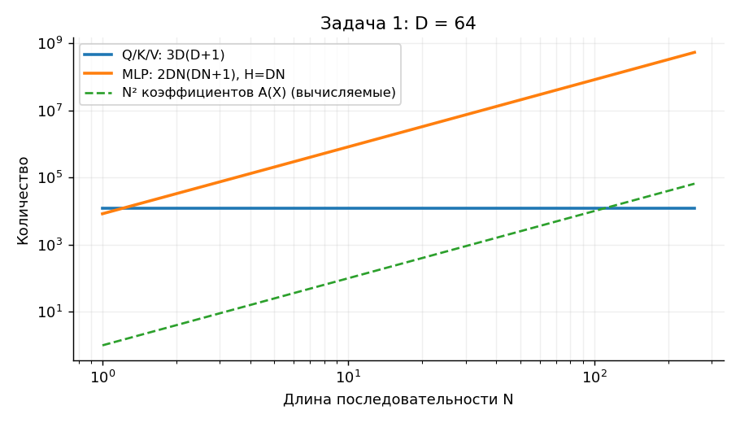
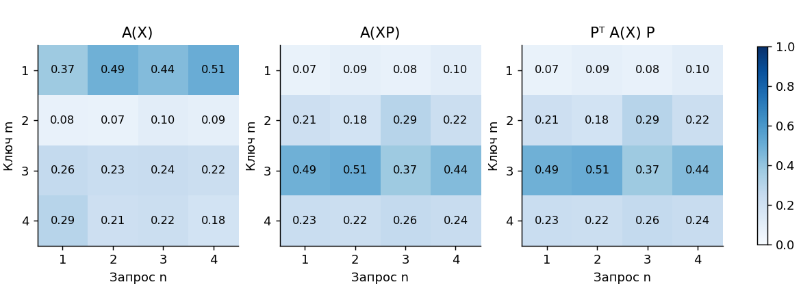
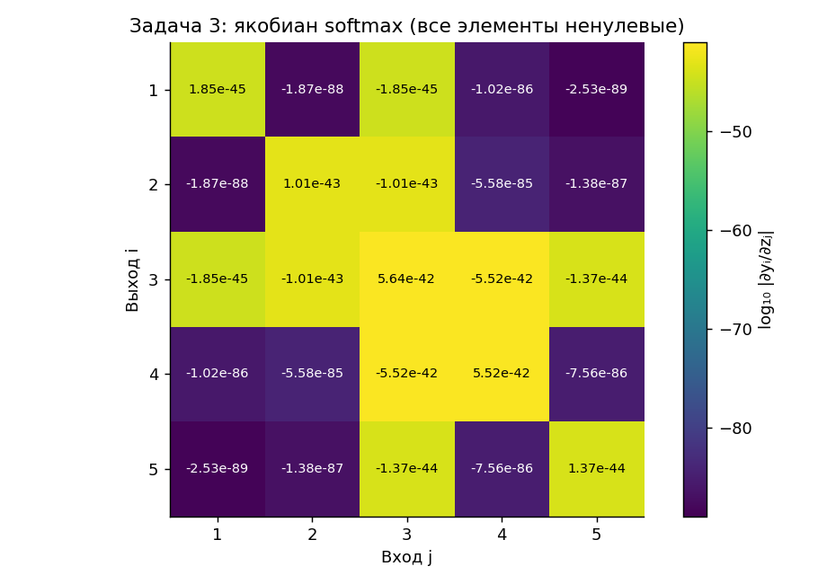

# Лабораторная работа 6а. Самовнимание и слои трансформеров

**Отчёт по всем трём задачам [lab6a.pdf](../lab6a.pdf).**
Используются обозначения лекций [5](../lecture5aa.pdf) и [6](../lecture6a.pdf).
Код: [`transformer_lab`](src/transformer_lab). Числа и рисунки получены командой
`python -m transformer_lab report`; обновление таблиц — `python tools/fill_tables.py`.
Полные результаты: [JSON](results/summary.json), [таблицы](results/tables.md),
[якобиан в CSV](results/jacobian.csv).

## 1. Число параметров блока самовнимания

### 1.1. Веса и смещения для значений, ключей и запросов

Дано $N$ входных векторов длины $D$. Соберём их в матрицу
$X=[x_1,\ldots,x_N]\in\mathbb R^{D\times N}$.
Для всех позиций используются **одни и те же** три аффинных преобразования:

```math
V=W_vX+b_v\mathbf{1}^T,\qquad
K=W_kX+b_k\mathbf{1}^T,\qquad
Q=W_qX+b_q\mathbf{1}^T.
```

Каждая матрица весов $W_v,W_k,W_q$ имеет размер $D\times D$, каждое
смещение — вектор длины $D$. Поэтому общее число обучаемых параметров:

```math
\boxed{\underbrace{3D^2}_{\text{веса}}+
\underbrace{3D}_{\text{смещения}}=3D(D+1).}
```

Это количество **не зависит от $N$**. Смещение добавляется к каждому
столбцу, но хранится и обучается один раз. Выходная проекция многоголового
внимания, позиционные эмбеддинги, LayerNorm и полносвязная часть полного
слоя трансформера здесь не учитываются: в задаче задан только блок Q/K/V.

### 1.2. Сколько параметров в матрице внимания

В соглашении лекции:

```math
S=K^TQ\in\mathbb R^{N\times N},\qquad
A_{mn}(X)=\frac{\exp S_{mn}}{\sum_{r=1}^{N}\exp S_{rn}},\qquad
\mathrm{Sa}(X)=V(X)A(X).
```

Матрица внимания содержит **$N^2$ скалярных коэффициентов**: каждый из $N$
выходов учитывает каждый из $N$ входов. Но **собственных независимо
обучаемых параметров у неё 0**: значения $A_{mn}$ вычисляются по текущему
входу и параметрам Q/K. Таким образом, если под «параметрами матрицы»
имеются в виду её элементы, ответ $N^2$; если веса модели — 0 дополнительных.

В каждом столбце $A$ сумма равна 1 и все элементы положительны.
У произвольной положительной матрицы с такой нормировкой $N(N-1)$ степеней
свободы. Это не означает наличие $N(N-1)$ независимых обучаемых весов
внимания: представление через $K^TQ$ и общие преобразования дополнительно
ограничивает множество реализуемых матриц.

Для фиксированного $D$ проекции требуют порядка $ND^2$ операций, а
формирование плотной матрицы внимания и умножение $VA$ — порядка $N^2D$.
Хранение явно вычисленной $A$ требует порядка $N^2$ памяти. Независимость
числа весов от длины последовательности не означает линейную стоимость
всего блока.

### 1.3. Аналогичный двухслойный перцептрон

Развернём вход в вектор длины $M=DN$. Под двухслойным перцептроном
понимаем **два обучаемых аффинных слоя** с нелинейностью между ними:

```math
f(x)=W_2\varphi(W_1x+b_1)+b_2,\qquad
W_1\in\mathbb R^{H\times M},\quad W_2\in\mathbb R^{M\times H}.
```

Для скрытой ширины $H$ число параметров равно:

```math
\boxed{MH+H+MH+M=2DNH+H+DN.}
```

**Скрытая ширина в условии не указана**, поэтому без предположения о $H$
единственного численного выражения только через $D,N$ нет. При одинаковой
ширине всех представлений, $H=DN$, получаем:

```math
\boxed{2(DN)^2+2DN=2DN(DN+1).}
```

При таком выборе число параметров MLP растёт квадратично с $N$; отношение
к Q/K/V составляет $2N(DN+1)/(3(D+1))$. Например, при $D=64,N=16$ это
2 099 200 против 12 480 параметров, примерно в 168 раз больше.
Это сравнение с полносвязной сетью на **всей развёрнутой последовательности**.
Позиционный MLP внутри обычного трансформера применяется с общими весами
к отдельным токенам и имеет другой подсчёт: $2DH+H+D$.

**Таблица 1.** Примеры для $D=64$, скрытая ширина MLP $H=DN$.

<!-- table:1 -->
| N | Q/K/V: веса + смещения | Элементы A(X) | MLP: веса + смещения | MLP / QKV |
|---|---|---|---|---|
| 1 | 12480 | 1 | 8320 | 0.667 |
| 4 | 12480 | 16 | 131584 | 10.544 |
| 16 | 12480 | 256 | 2099200 | 168.205 |
| 64 | 12480 | 4096 | 33562624 | 2689.313 |
| 256 | 12480 | 65536 | 536903680 | 43021.128 |
<!-- /table -->



*Рис. 1. Обучаемые веса и вычисляемые коэффициенты показаны отдельно.
При $N=1$ MLP с $H=D$ даже меньше блока с тремя проекциями; выигрыш по
параметрам появляется при увеличении длины последовательности.*

## 2. Эквивариантность самовнимания к перестановкам

Нужно доказать $\mathrm{Sa}(XP)=\mathrm{Sa}(X)P$. Здесь $P$ переставляет
**столбцы**: если $Pe_n=e_{\pi(n)}$, то $n$-й столбец $XP$ равен
$x_{\pi(n)}$. Это эквивариантность: выход переставляется тем же образом.
Равенство $\mathrm{Sa}(XP)=\mathrm{Sa}(X)$ в общем случае неверно.

### 2.1. Общие аффинные преобразования

Для матрицы перестановки $P^TP=PP^T=I$ и $\mathbf1^TP=\mathbf1^T$.
Поэтому смещения не нарушают нужное свойство:

```math
Q(XP)=W_qXP+b_q\mathbf1^T
=(W_qX+b_q\mathbf1^T)P=Q(X)P.
```

Точно так же $K(XP)=K(X)P$ и $V(XP)=V(X)P$. Следовательно,

```math
S(XP)=(K(X)P)^T(Q(X)P)=P^TS(X)P.
```

### 2.2. Перестановка и softmax

Обозначим нормировку каждого столбца через $\sigma$.
Покажем $\sigma(P^TSP)=P^T\sigma(S)P$. Поэлементно:

```math
\begin{aligned}
[\sigma(P^TSP)]_{mn}
&=\frac{\exp S_{\pi(m),\pi(n)}}
{\sum_{r=1}^{N}\exp S_{\pi(r),\pi(n)}}\\
&=\frac{\exp S_{\pi(m),\pi(n)}}
{\sum_{u=1}^{N}\exp S_{u,\pi(n)}}
=[\sigma(S)]_{\pi(m),\pi(n)}
=[P^T\sigma(S)P]_{mn}.
\end{aligned}
```

Во второй строке использовано то, что перестановка меняет только порядок
слагаемых в знаменателе. Итак, $A(XP)=P^TA(X)P$.

### 2.3. Выход блока

```math
\begin{aligned}
\mathrm{Sa}(XP)
&=V(XP)A(XP)\\
&=V(X)P\,P^TA(X)P\\
&=V(X)A(X)P
=\boxed{\mathrm{Sa}(X)P}.
\end{aligned}
```

Доказательство завершено для любых входов и весов. Деление $K^TQ$ на
скаляр $\sqrt D$ ничего не меняет, поэтому масштабированное самовнимание
также эквивариантно.

### 2.4. Численная проверка

Для матрицы из задания:

```math
P=\begin{pmatrix}
0&0&1&0\\1&0&0&0\\0&0&0&1\\0&1&0&0
\end{pmatrix},\qquad XP=[x_2,x_4,x_1,x_3].
```

В коде это порядок `[1, 3, 0, 2]` с нулевой индексацией. Веса, входы
и **ненулевые общие смещения** сгенерированы с фиксированными seed.
Для каждого размера сравниваются матрицы, а не только их нормы.

**Таблица 2.** Максимальная абсолютная ошибка в элементах выходов и внимания.

<!-- table:2 -->
| D | N | seed | Делитель | max abs ΔSa | max abs ΔA |
|---|---|---|---|---|---|
| 3 | 4 | 2026 | 1 | 2.220e-16 | 0.000e+00 |
| 3 | 4 | 2026 | √D | 3.331e-16 | 1.110e-16 |
| 8 | 7 | 7 | 1 | 8.882e-16 | 3.331e-16 |
| 8 | 7 | 7 | √D | 4.441e-16 | 2.220e-16 |
| 16 | 32 | 42 | 1 | 1.776e-15 | 4.441e-16 |
| 16 | 32 | 42 | √D | 8.882e-16 | 1.110e-16 |
<!-- /table -->

Остаточные ошибки соответствуют округлению `float64`. Дополнительно
автоматические тесты проверяют все $4!=24$ перестановки при $D=3,N=4$,
с масштабированием и без него. Численная проверка иллюстрирует тождество;
его обоснование — приведённое выше аналитическое доказательство.



*Рис. 2. Перестановка входов переставляет одновременно строки и столбцы
матрицы внимания. Две правые матрицы совпадают с точностью вычислений.*

### 2.5. Связь со слоями трансформеров

Результат объясняет необходимость позиционного кодирования в лекции 6.
Если $F(X)=\mathrm{Sa}(X+\Pi)$ с фиксированной матрицей позиций $\Pi$,
то $F(XP)=\mathrm{Sa}(XP+\Pi)$, а
$F(X)P=\mathrm{Sa}(XP+\Pi P)$. В общем случае это разные входы и выходы.
Если переставлять и токены, и их позиционные векторы, эквивариантность
сохраняется, но это уже другая операция над входом.

Фиксированная причинная маска или позиционная добавка к оценкам внимания
тоже не обязана сохраняться при произвольной перестановке; для сохранения
равенства её нужно преобразовать как $P^TMP$. Доказательство задачи
относится к самовниманию **без фиксированных позиционных ограничений**.

Несколько голов, общая выходная проекция, остаточное сложение, один и тот
же MLP для каждого токена и LayerNorm по признакам каждого токена сохраняют
эквивариантность. Поэтому сам по себе детерминированный слой трансформера
без позиционной информации и масок также не различает порядок токенов
иначе, чем через соответствующую перестановку выходов.

## 3. Все производные softmax

### 3.1. Аналитическая формула

Даны $z=(-3,1,100,5,-1)$ и

```math
y_i=\frac{e^{z_i}}{\sum_{k=1}^{5}e^{z_k}}.
```

Дифференцирование частного даёт:

```math
\frac{\partial y_i}{\partial z_j}
=\frac{\delta_{ij}e^{z_i}\sum_k e^{z_k}-e^{z_i}e^{z_j}}
{(\sum_k e^{z_k})^2}
=y_i(\delta_{ij}-y_j).
```

Следовательно,

```math
\boxed{J_{ij}=\begin{cases}
y_i(1-y_i),&i=j,\\
-y_iy_j,&i\ne j,
\end{cases}\qquad J=\operatorname{diag}(y)-yy^T.}
```

### 3.2. Устойчивое вычисление вероятностей и диагонали

Softmax не меняется при прибавлении общего скаляра к логитам, поэтому
вычтем максимум 100:

```math
t=(e^{-103},e^{-99},1,e^{-95},e^{-101}),\qquad
y_i=\frac{t_i}{1+\varepsilon},\qquad
\varepsilon=e^{-103}+e^{-99}+e^{-95}+e^{-101}.
```

**Таблица 3.** Значения softmax.

<!-- table:3 -->
| i | zᵢ | yᵢ (округление float64) |
|---|---|---|
| 1 | -3 | 1.8521167695e-45 |
| 2 | 1 | 1.0112214926e-43 |
| 3 | 100 | 1.0000000000e+00 |
| 4 | 5 | 5.5210822770e-42 |
| 5 | -1 | 1.3685394712e-44 |
<!-- /table -->

В точной арифметике $y_3<1$, причём
$1-y_3=\varepsilon/(1+\varepsilon)\approx5.63774194\cdot10^{-42}$.
В `float64` прибавление такого малого $\varepsilon$ к 1 округляется до 1,
и $y_3$ представляется числом `1.0`. Это не означает, что остальные
вероятности математически равны нулю: их величины нормально представимы
в этом формате. Проблема — потеря малой добавки при сложении с единицей,
а не переполнение или обнуление экспонент.

Для заданных логитов даже $e^{100}$ ещё помещается в `float64`, однако
вычитание максимума делает код устойчивым и для больших общих сдвигов.
Одна эта стабилизация не устраняет потерю точности в выражении $1-y_3$.
Поэтому диагональ вычисляется по эквивалентной формуле:

```math
J_{ii}=y_i\sum_{k\ne i}y_k=-\sum_{k\ne i}J_{ik}.
```

В ней складываются малые числа без вычитания почти равных величин.
Обычная запись `diag(y) - outer(y, y)` для этих данных даёт `J[2,2] = 0`,
а устойчивая — примерно $5.63774194\cdot10^{-42}$.

### 3.3. Численные значения всех 25 производных

Строка $i$ соответствует выходу $y_i$, столбец $j$ — входу $z_j$.
В таблице приведены значения в научной записи; ни одно из них не равно нулю.

**Таблица 4.** Якобиан $J_{ij}=\partial y_i/\partial z_j$.

<!-- table:4 -->
| i / j | 1 | 2 | 3 | 4 | 5 |
|---|---|---|---|---|---|
| 1 | 1.85211677e-45 | -1.87290028e-88 | -1.85211677e-45 | -1.02256891e-86 | -2.53469490e-89 |
| 2 | -1.87290028e-88 | 1.01122149e-43 | -1.01122149e-43 | -5.58303706e-85 | -1.38389653e-87 |
| 3 | -1.85211677e-45 | -1.01122149e-43 | 5.63774194e-42 | -5.52108228e-42 | -1.36853947e-44 |
| 4 | -1.02256891e-86 | -5.58303706e-85 | -5.52108228e-42 | 5.52108228e-42 | -7.55581902e-86 |
| 5 | -2.53469490e-89 | -1.38389653e-87 | -1.36853947e-44 | -7.55581902e-86 | 1.36853947e-44 |
<!-- /table -->



*Рис. 3. Цвет показывает десятичный логарифм модуля производной;
знак и само значение указаны в ячейке.*

Значения сверены с независимым вычислением формулы
$y_i(\delta_{ij}-y_j)$ через стандартный `decimal.Decimal` с **110 значащими
десятичными цифрами**. В тестах все 25 элементов сравниваются с
относительным допуском $5\cdot10^{-15}$ и **нулевым абсолютным допуском**.
Обычный абсолютный допуск $10^{-8}$ здесь бесполезен: с ним прошла бы
даже полностью нулевая матрица.

Дополнительная независимая проверка — центральные конечные разности
самой функции softmax с шагом $10^{-5}$ и арифметикой Decimal. Все элементы
согласуются с аналитическими значениями с относительным допуском
$3\cdot10^{-11}$. Для третьего выхода обычные конечные разности в `float64`
дали бы нули, поскольку обе близкие вероятности округляются до 1.

### 3.4. Выводы по якобиану

1. **Насыщение.** Третий логит превосходит ближайший, $z_4=5$, на 95.
   Почти весь вес получает третья компонента; остальные вероятности лежат
   примерно между $10^{-45}$ и $10^{-42}$. Максимальный модуль производной
   около $5.64\cdot10^{-42}$, а самые малые перекрёстные производные имеют
   порядок $10^{-89}$.
2. **Знаки.** Повышение $z_i$ увеличивает $y_i$ и уменьшает остальные
   вероятности: диагональ положительна, внедиагональные элементы отрицательны.
   Особенно заметна относительно остальных пара компонент 3 и 4: четвёртый
   логит — ближайший конкурент максимума.
3. **Сохранение суммы и общий сдвиг.** Якобиан симметричен, суммы его строк
   и столбцов равны нулю в точной арифметике. Сумма вероятностей всегда 1,
   а общий сдвиг всех логитов не меняет результат; $J\mathbf1=0$.
   При конечных логитах все вероятности положительны, и математический
   ранг здесь равен 4, хотя численное определение ранга при столь разных
   масштабах требует осторожности.
4. **Градиенты внимания.** При ограниченном по величине входящем градиенте
   умножение на этот якобиан резко уменьшает градиент по логитам. Если
   подобная насыщенная softmax вычисляет внимание, веса Q/K могут обучаться
   очень медленно. Это объясняет масштабирование в лекции 6.
5. **Граница вывода.** Малость якобиана softmax не означает, что градиент
   любой функции потерь обязательно мал. Например, для кросс-энтропии с
   целевым распределением $t$ имеем $\partial L/\partial z=y-t$; при уверенном
   неверном ответе он может оставаться большим.

### 3.5. Связь с масштабированием внимания

Если компоненты ключей и запросов независимы, центрированы и имеют единичную
дисперсию, дисперсия их скалярного произведения из $D_q$ слагаемых равна
$D_q$. Поэтому перед softmax используют $K^TQ/\sqrt{D_q}$: это сохраняет
характерный масштаб оценок порядка единицы при росте размерности ключа.
Предположения о распределении здесь существенны; масштабирование не
гарантирует отсутствие насыщения для любых входов.

Для иллюстрации пересчитаем заданный вектор как $y=\mathrm{softmax}(z/s)$.
Здесь $s$ — просто выбранный делитель. **Пять логитов не определяют $D_q$**:
длина столбца матрицы внимания — число токенов, а $D_q$ — размерность
ключей и запросов. Строка $s=\sqrt5$ в таблице — численный пример,
а не вывод размерности ключей из условия задачи 3.

**Таблица 5.** Производные взяты по исходным $z$, то есть учтено цепное правило
$\partial y/\partial z=[\operatorname{diag}(y)-yy^T]/s$.

<!-- table:5 -->
| s в softmax(z/s) | max yᵢ | max abs ∂yᵢ/∂zⱼ |
|---|---|---|
| 1 | 1.0000000000 | 5.63774194e-42 |
| 2.23607 | 1.0000000000 | 1.99957821e-19 |
| 10 | 0.9998003007 | 1.99659395e-05 |
| 100 | 0.4033000178 | 2.40649113e-03 |
<!-- /table -->

Даже деление на $\sqrt5$ оставляет этот конкретный вектор сильно насыщенным.
Большее $s$ делает вероятности менее сосредоточенными; при этом множитель
$1/s$ тоже влияет на градиент. Поэтому нельзя заключать, что неограниченное
увеличение делителя всегда ускоряет обучение.

## 4. Воспроизводимость и соответствие заданию

| Задача | Аналитическое решение | Код и результат |
|---|---|---|
| 1 | раздел 1: $3D(D+1)$; $N^2$ коэффициентов и 0 дополнительных весов; $2DNH+H+DN$ | `counts.py`, таблица 1, рис. 1 |
| 2 | раздел 2: преобразования Q/K/V, softmax и выхода | `attention.py`, таблица 2, рис. 2; все 24 перестановки в тестах |
| 3 | раздел 3: вывод якобиана, все 25 чисел и выводы | `softmax.py`, таблицы 3–5, рис. 3, `results/jacobian.csv` |

Расчёты выполняются без обучения и внешних наборов данных. Для численных
примеров фиксированы seed, использована арифметика NumPy `float64`, а
эталон softmax рассчитан средствами стандартной библиотеки Python.
Значения погрешностей на уровне машинного округления могут незначительно
отличаться между версиями NumPy и реализациями BLAS.

Порядок полного воспроизведения из каталога `lab6a`:

```bash
python -m transformer_lab report
python tools/fill_tables.py
python -m pytest
ruff check src tests tools
python tools/build_pdf.py
```

## Источники

1. Сукин И. А. [Задачи, lab6a.pdf](../lab6a.pdf), задачи 1–3, с. 1–2.
2. Сукин И. А. [Трансформеры. Самовнимание, lecture5aa.pdf](../lecture5aa.pdf),
   с. 7–12: общие проекции значений, ключей и запросов, матричная форма.
3. Сукин И. А. [Слои трансформеров, lecture6a.pdf](../lecture6a.pdf),
   с. 2–7: позиционное кодирование, масштабирование, несколько голов,
   остаточные связи, LayerNorm и позиционный MLP.
